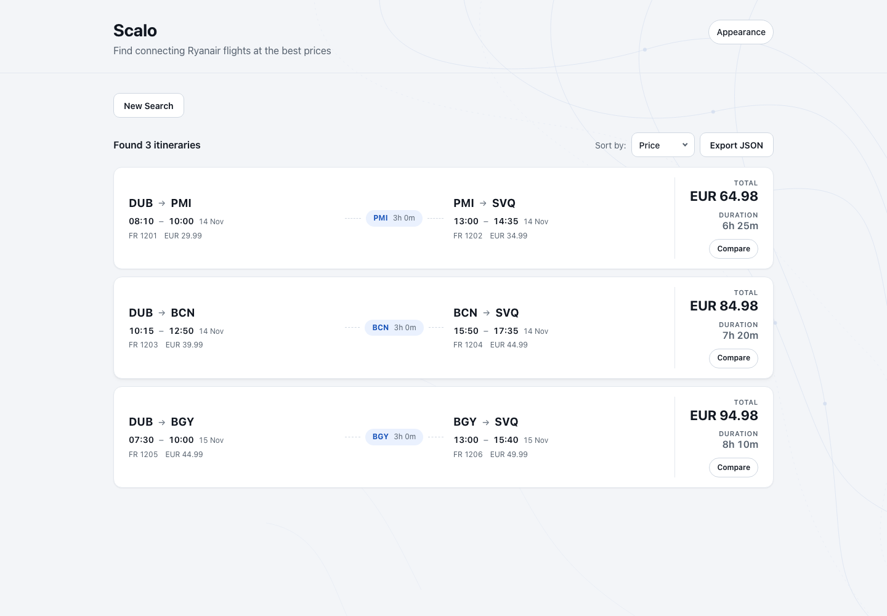
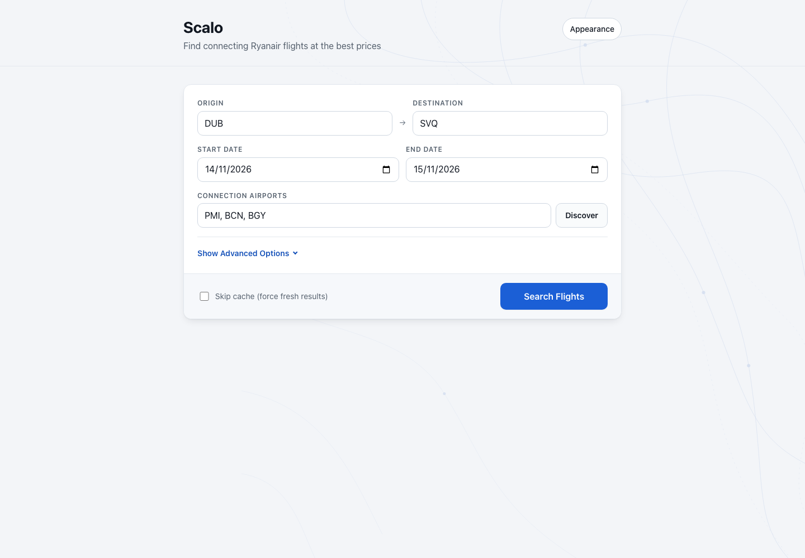
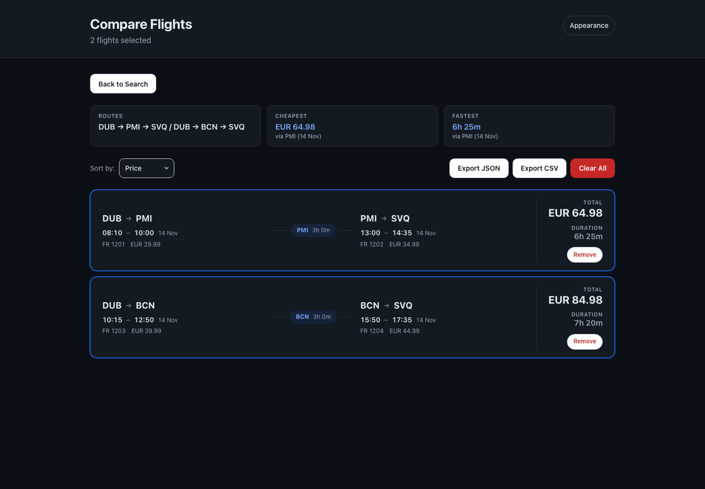

<h1 align="center">Scalo</h1>

<p align="center">
  <em>When no single Ryanair flight fits, two might.<br>
  This finds the pairs that connect, cheapest first.</em>
</p>

<p align="center">
  <a href="https://github.com/vitofico/scalo/actions/workflows/ci.yml"></a>
  <a href="LICENSE"></a>
  
</p>

<p align="center">
  <a href="docs/assets/readme-results-light.png"></a>
</p>

<p align="center"><em>A completed search, ready to shortlist. Screenshots use illustrative fares, not live offers.</em></p>

## What it is

Say you want to get from Dublin to Seville. There is a direct Ryanair flight, but maybe not on your day, or not at your price. Ryanair also flies Dublin to Palma and Palma to Seville, and Dublin to Barcelona and Barcelona to Seville. It mostly sells its flights one at a time, though, so its search won't offer you those pairs as one trip.

Those trips exist. They are simply two bookings that nobody is joining up for you. Scalo (Italian for a stopover) does the joining: it finds airports served from both ends, prices each leg separately across a date range, keeps only the pairs that actually connect in time, and ranks what survives by total cost.

Two surfaces, same engine:

- **CLI** for scripted or repeatable searches, with JSON output for piping.
- **Web UI** (React + FastAPI) for browsing and comparing results, with live search progress.

```
        ┌── discover ──> airports served from BOTH ends
        │
DUB ────┤   BGY  BLQ  STN  ...        ← candidate stopovers
        │
        └── search ────> price leg 1 + leg 2 per day, keep valid connections
                              │
                              ▼
                    ranked by total price
```

> [!IMPORTANT]
> These are **two separately booked one-way flights**, not a protected connection. If the first leg is delayed or cancelled, you have no rebooking rights on the second and no compensation claim for the missed connection. Leave a generous layover and understand you are carrying that risk yourself.

## Contents

- [Disclaimer](#disclaimer)
- [Install](#install)
- [Docker](#docker)
- [Quick start](#quick-start)
- [Web UI](#web-ui)
- [Command reference](#command-reference)
- [How it works](#how-it-works)
- [Caching](#caching)
- [Development](#development)
- [License](#license)

## Disclaimer

This is an independent personal project, built for personal and educational use. It is **not affiliated with, endorsed by, or connected to Ryanair** in any way.

It queries Ryanair's undocumented public JSON endpoints, the same ones their website calls. Those endpoints are not a supported API: they can change or disappear without notice, and using them may conflict with Ryanair's Terms of Use. You are responsible for deciding whether your use is appropriate, and for keeping request volume reasonable. The software is provided without warranty of any kind, and the author accepts no liability for how it is used.

## Install

Requires Python 3.11 or newer.

```bash
git clone https://github.com/vitofico/scalo.git
cd scalo

uv sync          # recommended
# or
pip install -e .
```

## Docker

One command, no Python or Node toolchain required:

```bash
docker compose up
```

Open http://127.0.0.1:8080. The image builds the frontend and serves it from the same process as the API, so there is nothing else to start.

The published port is pinned to `127.0.0.1` deliberately. The API has no authentication and no rate limiting, and one search fans out hundreds of requests to Ryanair from your IP address, so loopback keeps that off your local network. Do not widen it to `0.0.0.0` unless you have put something in front of it.

The price cache lives in a named volume mounted at `/data`, which is the container's working directory, so it survives restarts and rebuilds. The container runs as a non-root user and reports health by polling its own `/openapi.json`.

The same image carries the CLI:

```bash
docker compose run --rm web scalo discover --origin DUB --destination SVQ
```

Stop and remove the container, keeping the cache:

```bash
docker compose down
```

## Quick start

### 1. Find the candidate stopovers

Work out which airports Ryanair serves from **both** your origin and your destination:

```bash
scalo discover --origin DUB --destination SVQ
```

Results are saved to `connections.json`, which `search` picks up automatically.

### 2. Search

```bash
scalo search --origin DUB --destination SVQ \
    --start 2026-03-01 --end 2026-03-07
```

```
========================================================================================================================
  # | First Leg                      | Connection   | Second Leg                     |      Total |   Duration
------------------------------------------------------------------------------------------------------------------------
  1 | DUB->BGY 03/03 06:20-10:05     | BGY (3h 10m) | BGY->SVQ 03/03 13:15-15:40     |  EUR 74.98 |     8h 20m
  2 | DUB->STN 03/05 09:15-10:45     | STN (3h 20m) | STN->SVQ 03/05 14:05-17:50     |  EUR 81.50 |     7h 35m
========================================================================================================================
Total: 2 itineraries
```

`--origin` and `--destination` are required on both commands.

## Web UI

The browser app is the friendly face of the same search the CLI runs. You pick an origin, a destination, a date range and the airports you are willing to connect through, and progress streams in while the search runs: a progress bar fills as each connection airport is priced, so you see how far along it is rather than staring at a spinner. The ranked results appear when the search finishes.

Each result is a card that shows both legs of the journey with the layover marked on the route line between them, so you can scan flight times, the stopover airport and how long you are stuck there at a glance. The total price and total duration sit together at the end of the card. Anything promising can be added to the compare view, which shows the selected journeys together, highlights the cheapest and the fastest, and exports them as JSON or CSV.

<p align="center">
  <a href="docs/assets/readme-search-light.png"></a>
</p>

Use **Discover** to fill the connection airports, then search your date range.
Sort results by **Price**, **Duration** or **Layover**. Add promising routes with
**Compare** and open **Compare (n)** to compare the shortlist and export it
as JSON or CSV. The shortlist lasts for the current page session; export it
before refreshing or closing the tab.

<p align="center">
  <a href="docs/assets/readme-compare-dark.png"></a>
</p>

The interface follows your system's light or dark colours. Open **Appearance**
in the header to choose **Artwork** for the route-map background or **Plain**
for solid surfaces; that choice is saved in this browser. It is built for a phone as much as a laptop, so the form, the progress panel and the result cards all reflow down to narrow screens. Keyboard users get visible focus rings throughout, and motion is disabled if you have asked your system to reduce it.

Appearance offers Plain and Artwork previews. Artwork adds blue route contours; Plain keeps solid surfaces. The choice stays in this browser and is independent of the system light or dark theme.

For development, run the two processes separately:

```bash
# Terminal 1: API on :8000
uv run scalo-web

# Terminal 2: Vite dev server on :5173
cd frontend && npm run dev
```

Open http://localhost:5173. Progress streams over SSE, so long searches report as they go rather than blocking on a spinner.

To run it as one process, build the frontend and let the backend serve it:

```bash
cd frontend && npm run build
uv run scalo-web       # now serves UI + API on :8000
```

> [!WARNING]
> **Run this locally only.** The web API has no authentication and no rate limiting, and one search fans out hundreds of outbound requests to Ryanair. Anyone who can reach the port can drive that traffic from your IP address. The CLI binds `127.0.0.1` by default, and `docker compose` publishes the port on `127.0.0.1` too. If you change either, put authentication in front of it first.

## Command reference

### `discover`

```bash
scalo discover --origin DUB --destination SVQ [--no-cache] [--debug]
```

Intersects the destination lists of both airports to produce the candidate stopovers.

### `search`

```bash
scalo search --origin DUB --destination SVQ \
    --start YYYY-MM-DD --end YYYY-MM-DD \
    [--connections BGY,BLQ] [--currency EUR] \
    [--min-connection-minutes 60] [--max-connection-hours 12] \
    [--allow-overnight] [--output table|json] \
    [--no-cache] [--debug]
```

| Option | Default | Description |
|--------|---------|-------------|
| `--origin` | **required** | Origin airport IATA code |
| `--destination` | **required** | Destination airport IATA code |
| `--start` | **required** | Start of date range |
| `--end` | **required** | End of date range |
| `--connections` | auto | Comma-separated stopovers, overriding `connections.json` |
| `--currency` | `EUR` | Currency for prices |
| `--min-connection-minutes` | `60` | Shortest acceptable layover |
| `--max-connection-hours` | `12` | Longest acceptable layover |
| `--allow-overnight` | `false` | Allow the second leg to depart the next day |
| `--output` | `table` | `table` for humans, `json` for scripts |
| `--no-cache` | `false` | Bypass the response cache |
| `--debug` | `false` | Show debug output |

Results go to stdout and progress to stderr, so JSON pipes cleanly:

```bash
scalo search --origin DUB --destination SVQ \
    --start 2026-03-01 --end 2026-03-07 --output json > results.json
```

## How it works

1. **Route discovery.** Ryanair publishes the destinations served from each airport. Intersecting the origin's list with the destination's gives the airports that could act as a stopover.
2. **Schedule.** For each leg the tool reads Ryanair's monthly timetable, which lists every scheduled flight on every day, so it never spends requests pricing empty days.
3. **Fares.** Each scheduled flight is priced on its own, throttled to stay polite, with responses cached. Ryanair's fare endpoint only ever returns the cheapest fare matching a query, so pricing a whole day at once would hide every flight but one.
4. **Connection building.** A pair survives only when the second leg departs after the first arrives, inside your layover bounds, same day unless `--allow-overnight`.
5. **Ranking.** Survivors are sorted by total price, then by arrival time.

## Caching

Responses land in a local SQLite database (`ryanair_cache.db`) with a 6 hour TTL. Repeat searches are near-instant and cost Ryanair nothing. Use `--no-cache` to force fresh data.

## Development

See [CONTRIBUTING.md](CONTRIBUTING.md) for the full workflow.

```bash
uv sync --group dev
uv run pytest          # 80% coverage floor
uv run ruff check .    # lint
uv run ruff format .   # format
uv run mypy            # strict type check
```

Or use the Makefile. Run `make` on its own to list every target.

| Target | What it does |
|--------|--------------|
| `install` | `uv sync --group dev` |
| `test` | pytest with an 80% coverage floor |
| `lint` | `ruff check .` and `ruff format --check .` |
| `format` | reformat in place |
| `typecheck` | strict mypy |
| `check` | lint, typecheck and test, the same set CI runs |
| `run` | serve the web UI on http://127.0.0.1:8000 |
| `docker-build` | build the image without starting it |

```
src/scalo/
  cli.py          Command-line interface and argument parsing
  api_client.py   Ryanair HTTP client with retries and rate limiting
  cache.py        SQLite response cache
  search.py       Search orchestration
  itinerary.py    Itinerary builder and connection validation
  models.py       Flight and Itinerary data models
  output.py       Table and JSON formatters
  exceptions.py   Domain exception types
  webapi/         FastAPI backend (routers, SSE job manager)
frontend/         React + Vite frontend
```

## License

MIT. See [LICENSE](LICENSE).
